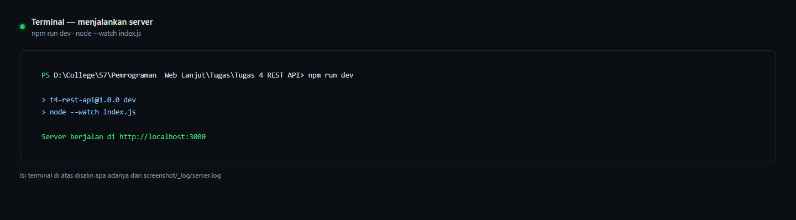
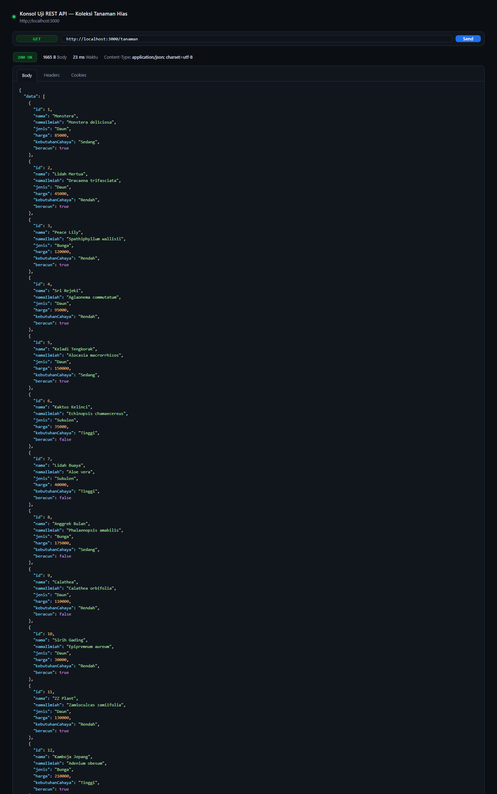
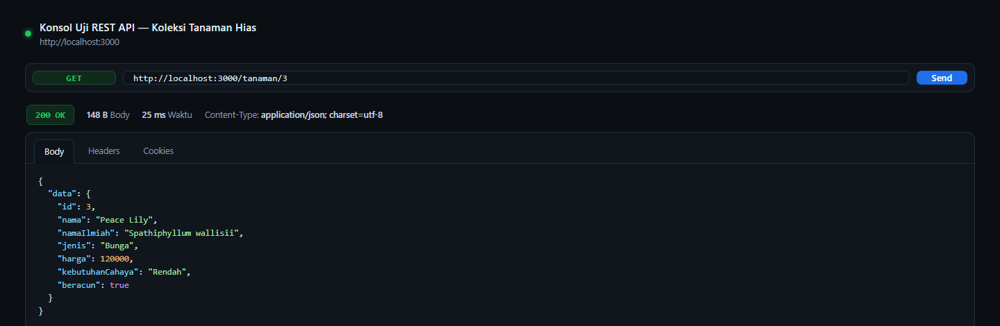
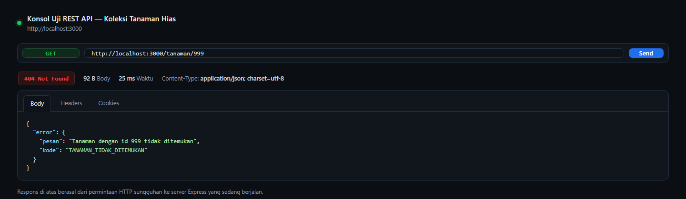
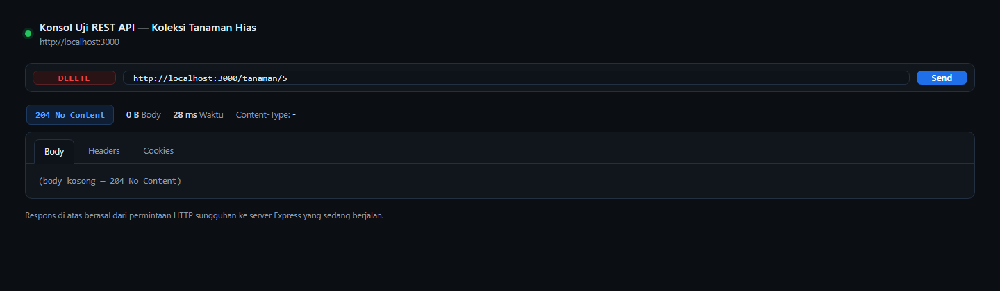
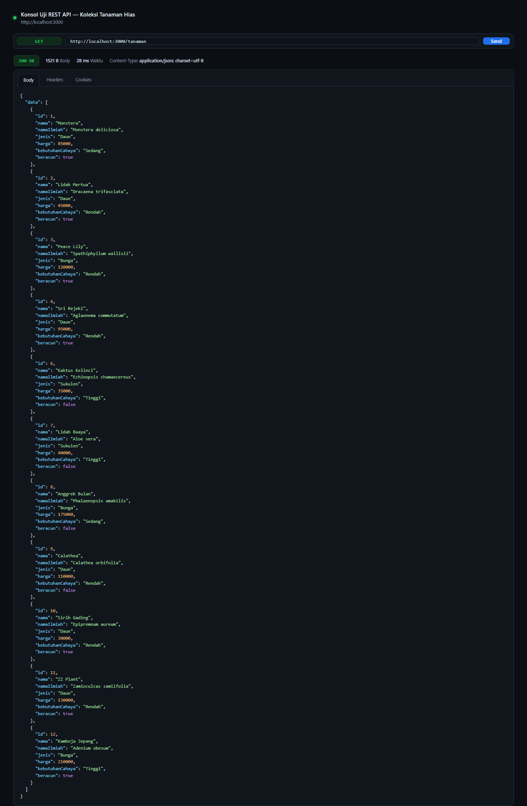

# Tugas 4 — REST API Dasar (Koleksi Tanaman Hias)

## Identitas

- **Nama** : Ahmad Ramadhani R.
- **NIM** : F1D02310102
- **Mata Kuliah** : Pemrograman Web Lanjut
- **Topik data** : Koleksi tanaman hias (`/tanaman`)

## Deskripsi Tugas

Tugas ini membuat REST API sederhana dengan Express untuk resource **tanaman hias**.
Saya memilih topik ini karena saya ikut merawat tanaman di rumah, jadi datanya mudah
diverifikasi satu per satu (nama ilmiah, harga pasar, kebutuhan cahaya). Topiknya juga
sengaja berbeda dari API Mahasiswa di materi dan dari contoh `buku` / `tempat-makan` di
soal.

Data disimpan sebagai *array of object* di `src/data/tanaman.js` berisi **12 data**,
masing-masing punya `id` dan 6 field lain. Data hanya hidup di memori, jadi kalau server
di-restart data kembali ke kondisi awal (12 tanaman).

## Cara Menjalankan

```bash
npm install
npm run dev
```

Server berjalan di <http://localhost:3000>.

Uji cepat tanpa Postman:

```bash
curl http://localhost:3000/tanaman
curl http://localhost:3000/tanaman/3
curl http://localhost:3000/tanaman/999
curl -X DELETE http://localhost:3000/tanaman/5
```

## Struktur Proyek

```
T4-REST-API/
├── src/
│   └── data/
│       └── tanaman.js      # data array of object (12 tanaman)
├── screenshot/             # bukti pengujian
├── screenshot/_log/        # bukti mentah: log respons + skrip uji
├── index.js                # server Express + semua route
├── requests.http           # kumpulan request untuk VS Code REST Client
├── package.json            # type: module, script dev (node --watch)
├── .gitignore              # node_modules
└── README.md
```

## Daftar Endpoint

| Method | URL | Fungsi | Status |
|--------|-----|--------|--------|
| GET | `/` | Teks sambutan | 200 |
| GET | `/tanaman` | Menampilkan semua tanaman | 200 |
| GET | `/tanaman/:id` | Menampilkan satu tanaman berdasarkan `id` | 200 / 404 |
| DELETE | `/tanaman/:id` | Menghapus satu tanaman (opsional/bonus) | 204 / 404 |

Format response selalu sama:

```json
{ "data": { "id": 3, "nama": "Peace Lily" } }
```

```json
{ "error": { "pesan": "Tanaman dengan id 999 tidak ditemukan", "kode": "TANAMAN_TIDAK_DITEMUKAN" } }
```

Kode error yang dipakai: `TANAMAN_TIDAK_DITEMUKAN` (id tidak ada) dan
`ENDPOINT_TIDAK_DITEMUKAN` (URL tidak dikenal).

## Bentuk Data

Satu data dari `src/data/tanaman.js`:

```js
{
  id: 3,
  nama: "Peace Lily",
  namaIlmiah: "Spathiphyllum wallisii",
  jenis: "Bunga",
  harga: 120000,
  kebutuhanCahaya: "Rendah",
  beracun: true,
}
```

| Field | Tipe | Arti |
|-------|------|------|
| `id` | number | Identitas unik tanaman, dipakai di URL `/tanaman/:id` |
| `nama` | string | Nama populer tanaman |
| `namaIlmiah` | string | Nama ilmiah (latin) |
| `jenis` | string | Kelompok tanaman: `"Daun"`, `"Bunga"`, atau `"Sukulen"` |
| `harga` | number | Harga pasar dalam rupiah |
| `kebutuhanCahaya` | string | `"Rendah"`, `"Sedang"`, atau `"Tinggi"` |
| `beracun` | boolean | `true` kalau berbahaya bila tertelan hewan peliharaan |

## Pengujian

Screenshot diambil dari respons **sungguhan** server Express yang sedang berjalan
(`npm run dev`), dengan klien HTTP di `screenshot/_log/konsol-uji.html`.
Log mentah tiap request (method, URL, status, body) ada di `screenshot/_log/*.txt`.

### 1. Server berjalan (`npm run dev`)



### 2. `GET /tanaman` — daftar semua data (200)

12 data tampil semua.



### 3. `GET /tanaman/3` — id ada (200)



### 4. `GET /tanaman/999` — id tidak ada (404)



### 5. `DELETE /tanaman/5` — berhasil (204 No Content)



### 6. `GET /tanaman` lagi — data id 5 sudah hilang (11 data)



### 7. `DELETE /tanaman/5` lagi — id sudah tidak ada (404)

```
STATUS : 404
{"error":{"pesan":"Tanaman dengan id 5 tidak ditemukan","kode":"TANAMAN_TIDAK_DITEMUKAN"}}
```

## Deklarasi Penggunaan AI

| Bagian | Alat AI | Dipakai untuk apa | Bagaimana saya memeriksa hasilnya |
|--------|---------|-------------------|-----------------------------------|
| Data (`src/data/tanaman.js`) | OpenCode (agen AI) | Membuat 12 contoh data tanaman hias beserta field `namaIlmiah`, `harga`, `kebutuhanCahaya` | Saya cocokkan nama ilmiah tiap tanaman dan perkiraan harganya sendiri, lalu cek jumlah datanya 12 dengan `GET /tanaman` |
| `index.js` (route GET, 404, DELETE) | OpenCode (agen AI) | Menulis kerangka server Express dan route `/tanaman`, `/tanaman/:id`, `DELETE /tanaman/:id` | Saya baca ulang kodenya baris per baris, lalu uji tiap endpoint: 200, 200, 404, 204, dan 404 lagi |
| Format response `{ data }` / `{ error }` | OpenCode (agen AI) | Menyeragamkan bentuk response berhasil dan gagal | Saya bandingkan body tiap respons di screenshot dengan format yang diminta soal |
| `package.json`, `.gitignore`, `requests.http` | OpenCode (agen AI) | Menyiapkan `type: module`, script `dev` pakai `--watch`, dan daftar request uji | Saya jalankan `npm install` lalu `npm run dev` di komputer sendiri sampai server hidup di port 3000 |
| README.md | OpenCode (agen AI) | Menyusun dokumentasi (identitas, endpoint, bentuk data, kesimpulan) | Saya sesuaikan isinya dengan hasil uji saya sendiri dan ganti bagian yang tidak cocok |
| Skrip & tampilan screenshot (`screenshot/_log`) | OpenCode (agen AI) | Membuat skrip pengujian dan tampilan klien HTTP agar screenshot menampilkan respons asli | Saya cek isi `screenshot/_log/*.txt` dan pastikan status serta body-nya sama dengan yang tampil di screenshot |

**Contoh prompt yang saya pakai:**

> "Buat REST API Express untuk tugas kuliah dengan data sendiri, topik koleksi tanaman
> hias, minimal 10 data dengan id dan minimal 3 field lain. Route wajib GET daftar dan
> GET detail (404 kalau id tidak ada), plus DELETE opsional yang mengembalikan 204.
> Format response berhasil `{ data: ... }` dan gagal `{ error: { pesan, kode } }`.
> Simpan data di src/data/tanaman.js, pakai type module dan script dev dengan --watch."

**Pernyataan:** Saya menggunakan AI pada bagian yang tertulis di tabel di atas. Saya
sudah menjalankan sendiri proyeknya, menguji setiap endpoint, dan membaca ulang kode
yang dihasilkan sebelum dikumpulkan. Bagian lain (pemilihan topik, pengecekan data,
pengambilan screenshot, dan penyesuaian README) saya kerjakan sendiri.

## Kesimpulan & Kendala

**Yang saya pelajari**

- Cara membuat server Express dengan ES Module (`type: "module"`) dan `node --watch`
  supaya server restart otomatis saat file diubah.
- Route dinamis `/:id` dan pentingnya mengubah `req.params.id` dari string ke angka
  sebelum dibandingkan dengan `id` di data.
- Perbedaan status code yang tepat: `200` untuk data ada, `204` untuk hapus berhasil
  (tanpa body), `404` untuk data yang tidak ada.
- Konsistensi format response membuat klien lebih mudah memproses hasil, karena bentuk
  sukses dan gagal selalu bisa dibedakan dari ada/tidaknya `data` atau `error`.

**Kendala dan cara mengatasinya**

1. **`GET /tanaman/3` sempat selalu 404.** Ternyata `req.params.id` bertipe string,
   jadi `"3" === 3` selalu `false`. Solusinya `const id = Number(req.params.id)`
   sebelum `find()`.
2. **`DELETE` tidak bisa mengosongkan array.** Array hasil `import` tidak bisa
   di-assign ulang (`tanaman = ...` error). Solusinya `findIndex()` lalu `splice()`
   pada array yang sama.
3. **`204` sempat mengirim body.** Kalau memakai `res.json()` dengan status 204,
   Express tetap mengirim body kosong yang tidak sesuai standar. Solusinya
   `res.status(204).end()`.
4. **Data hilang setelah restart.** Ini perilaku normal karena data hanya di memori
   (tidak ada database), jadi bukan bug.
